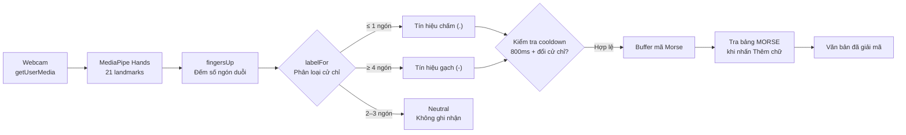

<div align="center">

# ✋ Morse Hand

### Chạm tay, viết Morse — Nhận diện cử chỉ bàn tay qua webcam để nhập và giải mã mã Morse theo thời gian thực.

<br/>


</div>

---

## 📖 Giới thiệu

**Morse Hand** là một ứng dụng web (*web application*) cho phép người dùng nhập mã Morse (*Morse code*) mà không cần bàn phím — chỉ bằng cử chỉ bàn tay trước webcam.

Ứng dụng sử dụng **MediaPipe Hands** để theo dõi 21 điểm mốc (*landmarks*) trên bàn tay theo thời gian thực (*real-time hand tracking*), đếm số ngón tay đang duỗi bằng logic dựa trên luật (*rule-based gesture classification*), từ đó suy ra tín hiệu chấm (`.`) hoặc gạch (`-`). Các tín hiệu được cộng dồn vào một bộ đệm (*buffer*), rồi tra cứu trong bảng mã Morse (*lookup table*) để giải mã thành chữ cái (A–Z) và chữ số (0–9).

Toàn bộ quá trình xử lý diễn ra ngay trên trình duyệt (*client-side*) — không cần backend, không cần cài đặt thư viện qua `npm`, chỉ cần mở trang web và cấp quyền camera.

### ✨ Tính năng chính

- 🎥 **Nhận diện bàn tay theo thời gian thực** — Theo dõi tối đa 1 bàn tay (`maxNumHands: 1`) với độ tin cậy phát hiện và theo dõi (*detection/tracking confidence*) ở mức `0.7`.
- 🖐️ **Phân loại cử chỉ bằng thuật toán đếm ngón** — Hàm `fingersUp()` so sánh vị trí đầu ngón (*finger tips*) với khớp PIP (*Proximal Interphalangeal*) và xử lý riêng ngón cái để đếm số ngón đang duỗi.
- 🔤 **Giải mã Morse đầy đủ A–Z và 0–9** — Bảng tra cứu `MORSE` gồm 36 ký tự; mã không hợp lệ sẽ hiển thị ký tự thay thế `�` kèm thông báo *"Mã chưa hợp lệ"* thay vì gây lỗi.
- ⏱️ **Cơ chế chống trùng lặp (*anti-repeat / cooldown*)** — Một tín hiệu chỉ được ghi nhận khi cử chỉ **thay đổi** so với cử chỉ trước đó **và** đã qua `800ms` kể từ tín hiệu cuối cùng, tránh việc giữ nguyên một cử chỉ bị ghi thành nhiều ký tự.
- 🦴 **Vẽ khung xương bàn tay trực tiếp lên Canvas** — Hiển thị các đường nối (*connectors*) và điểm mốc (*landmarks*) theo thời gian thực ngay trên khung hình camera (đã lật gương — *mirrored* — để thao tác tự nhiên).
- 🔔 **Phản hồi trạng thái trực quan (*live feedback*)** — Huy hiệu cử chỉ (*gesture badge*: "Nắm tay · dấu chấm" / "Bàn tay mở · dấu gạch"), trạng thái camera (*"Đang nhận diện"*, *"Không thể mở camera"*) và gợi ý tín hiệu gần nhất (*signal hint*: "Đã thêm chấm", "→ A"...) cập nhật liên tục theo từng hành động.
- ✍️ **Thao tác biên tập văn bản thủ công** — Các nút **Thêm chữ** (chốt ký tự), **Dấu cách** (chốt ký tự + thêm khoảng trắng), **Xóa tín hiệu** (xóa chấm/gạch cuối trong bộ đệm hiện tại) và **Xóa tất cả** (xóa toàn bộ văn bản + bộ đệm).
- ♿ **Hỗ trợ tiếp cận (*accessibility*)** — Vùng văn bản đã giải mã dùng thuộc tính `aria-live="polite"` để trình đọc màn hình (*screen reader*) thông báo kết quả mới.
- 📱 **Giao diện đáp ứng (*responsive layout*)** — Bố cục lưới (*CSS Grid*) hai cột trên desktop tự chuyển thành một cột ở màn hình ≤ `720px`.

---

## ⚙️ Cách hoạt động

### 🔄 Luồng xử lý (*Processing Pipeline*)



### 🤚 Quy tắc cử chỉ (*Gesture Rules*)

| Cử chỉ / Thao tác | Cách thực hiện | Kết quả | Ghi chú kỹ thuật |
| :--- | :--- | :--- | :--- |
| ✊ **Nắm tay** | Gập các ngón tay lại (≤ 1 ngón duỗi) | Nhập dấu chấm **`.`** | Phân loại `dot` trong hàm `labelFor()` |
| 🖐️ **Mở bàn tay** | Duỗi thẳng các ngón tay (hiển thị 5 ngón; code ghi nhận khi ≥ 4 ngón duỗi) | Nhập dấu gạch **`-`** | Phân loại `dash` trong hàm `labelFor()` |
| ✌️ **Trạng thái trung gian (*Neutral*)** | Duỗi 2–3 ngón tay | Không ghi nhận tín hiệu | Dùng để "nhả" cử chỉ trước khi nhập tín hiệu tiếp theo |
| ⏳ **Thời gian chờ (*Cooldown*)** | Giữ/đổi cử chỉ sau mỗi tín hiệu | Chờ tối thiểu **0.8 giây** (`800ms`) | Tín hiệu mới chỉ được chấp nhận khi cử chỉ **khác** cử chỉ trước **và** đã qua thời gian cooldown kể từ tín hiệu cuối |
| 🔘 **Nút "Thêm chữ"** | Nhấn nút trên giao diện | Chốt (*commit*) cụm chấm/gạch hiện tại thành 1 ký tự | Tra cứu trong bảng `MORSE`; mã sai hiển thị `�` |
| ␣ **Nút "Dấu cách"** | Nhấn nút trên giao diện | Chốt ký tự hiện tại **và** thêm khoảng trắng | Tương đương "Thêm chữ" + ký tự `' '` |
| ⌫ **Nút "Xóa tín hiệu"** | Nhấn nút trên giao diện | Xóa chấm/gạch **cuối cùng** trong bộ đệm chưa chốt | Chỉ tác động lên mã đang nhập dở, không xóa ký tự đã chốt |
| 🗑️ **Nút "Xóa tất cả"** | Nhấn nút trên giao diện | Xóa toàn bộ văn bản đã dịch và bộ đệm hiện tại | Đặt lại ứng dụng về trạng thái ban đầu |

> 💡 **Mẹo sử dụng:** Sau khi ra dấu chấm/gạch, hãy chuyển tay về trạng thái trung gian (duỗi 2–3 ngón) hoặc đổi sang cử chỉ khác rồi quay lại — đây là thao tác bắt buộc để hệ thống ghi nhận tín hiệu tiếp theo, vì giữ nguyên một cử chỉ sẽ **không** bị tính lặp lại nhiều lần.

> ⚠️ **Hạn chế hiện tại:** Việc đếm ngón cái trong `fingersUp()` dựa trên so sánh tọa độ `x` của đầu ngón cái với khớp kề bên, nên kết quả có thể kém chính xác khi đổi tay trái/phải hoặc xoay nghiêng bàn tay. Hãy giữ lòng bàn tay hướng thẳng vào camera để nhận diện ổn định nhất.

---

## 🛠️ Công nghệ sử dụng (*Tech Stack*)

| Công nghệ | Vai trò trong dự án |
| :--- | :--- |
| **HTML5** | Cấu trúc trang (`index.html`): thẻ `<video>` nhận luồng camera, `<canvas>` vẽ kết quả, bố cục *semantic* với `<main>`, `<section>`, `<aside>` |
| **CSS3** | Giao diện (`style.css`): CSS Custom Properties (*variables*), CSS Grid, Flexbox, `clamp()` cho *fluid typography*, Media Query `@media (max-width: 720px)` cho responsive, hiệu ứng lật gương `transform: scaleX(-1)` |
| **Vanilla JavaScript (ES6+)** | Toàn bộ logic (`app.js`): không framework, không bundler — dùng `async/await`, arrow function, optional chaining (`?.`), template literals |
| **[MediaPipe Hands](https://developers.google.com/mediapipe/solutions/vision/hand_landmarker)** (`@mediapipe/hands`) | Mô hình *machine learning* phát hiện và trích xuất 21 landmarks 3D của bàn tay từ từng khung hình; cấu hình `modelComplexity: 1`, `minDetectionConfidence: 0.7`, `minTrackingConfidence: 0.7`; file mô hình (`.wasm`, `.tflite`) được tải qua `locateFile` từ CDN jsDelivr |
| **[Camera Utils](https://www.npmjs.com/package/@mediapipe/camera_utils)** (`@mediapipe/camera_utils`) | Tiện ích `Camera` bơm từng khung hình từ `<video>` vào MediaPipe qua callback `onFrame` ở độ phân giải 1280×720 |
| **[Drawing Utils](https://www.npmjs.com/package/@mediapipe/drawing_utils)** (`@mediapipe/drawing_utils`) | Cung cấp `drawConnectors()` + `HAND_CONNECTIONS` và `drawLandmarks()` để vẽ khung xương (màu `#c9f26b`) và các điểm khớp (màu `#ff7446`) lên Canvas |
| **MediaDevices `getUserMedia`** (WebRTC / Media Capture API) | Yêu cầu quyền và mở luồng webcam trực tiếp từ trình duyệt: `facingMode: 'user'`, độ phân giải lý tưởng 1280×720, không thu âm (`audio: false`); có xử lý lỗi (*try/catch*) khi người dùng từ chối quyền |
| **HTML5 Canvas 2D API** | Bề mặt vẽ (*rendering surface*): đồng bộ kích thước theo `videoWidth`/`videoHeight`, vẽ khung hình gốc (`drawImage`) rồi chồng lớp khung xương lên trên theo từng frame |
| **Google Fonts** | Bộ đôi font chữ **Manrope** (nội dung) và **DM Mono** (hiển thị mã Morse/monospace) qua `@import` trong CSS |

> 📦 Cả ba thư viện MediaPipe đều được nạp trực tiếp từ CDN (`cdn.jsdelivr.net`) bằng thẻ `<script>` — dự án **không có** `package.json` và không cần bước build (*zero-build setup*).

---

## 🚀 Hướng dẫn cài đặt & chạy dự án (*Local Setup*)

### Yêu cầu tiên quyết (*Prerequisites*)

- Một trình duyệt hiện đại có hỗ trợ `getUserMedia` và WebAssembly (khuyến nghị **Google Chrome** hoặc **Microsoft Edge** bản mới nhất).
- Webcam (tích hợp hoặc USB).
- Kết nối Internet trong lần tải đầu tiên (để tải thư viện MediaPipe, mô hình nhận diện tay và Google Fonts từ CDN).

### ⚠️ Lưu ý quan trọng về quyền Webcam

> Trình duyệt **chỉ cho phép truy cập webcam trong *secure context*** — tức là trang web phải được phục vụ qua **`https://`** hoặc **`http://localhost`**.
>
> ❌ Mở file trực tiếp bằng giao thức `file://` (nhấp đúp vào `index.html`) sẽ bị trình duyệt chặn quyền camera và ứng dụng không hoạt động.
>
> ✅ Hãy chạy một trong các cách dưới đây để phục vụ dự án qua `localhost`.

### Cách 1: VS Code Live Server (khuyến nghị cho người mới)

1. Mở thư mục dự án bằng **Visual Studio Code**.
2. Cài extension **Live Server** (tác giả: Ritwick Dey) từ Marketplace.
3. Nhấn chuột phải vào `index.html` → **Open with Live Server** (hoặc nhấn nút **Go Live** ở góc dưới-phải).
4. Trình duyệt tự mở tại `http://localhost:5500` (cổng mặc định). Nhấn **"Bật camera"** và cho phép quyền truy cập webcam.

### Cách 2: Python `http.server`

```bash
# Di chuyển vào thư mục dự án
cd morse-hand

# Python 3
python -m http.server 8000
```

Sau đó mở trình duyệt và truy cập: **http://localhost:8000**

### Cách 3: Node.js với `serve`

```bash
# Di chuyển vào thư mục dự án
cd morse-hand

# Chạy trực tiếp không cần cài đặt
npx serve .
```

Sau đó mở trình duyệt tại địa chỉ được hiển thị trên terminal (mặc định: **http://localhost:3000**).

### Bắt đầu sử dụng

1. Nhấn nút **"Bật camera"** và cấp quyền webcam khi trình duyệt yêu cầu.
2. Đưa **một bàn tay** vào khung hình, giữ lòng bàn tay hướng vào camera — chờ huy hiệu hiển thị *"Nắm tay · dấu chấm"* hoặc *"Bàn tay mở · dấu gạch"*.
3. ✊ Nắm tay để nhập `.` — 🖐️ mở tay để nhập `-` (nhớ đổi về trạng thái trung gian giữa hai tín hiệu liên tiếp).
4. Nhấn **"Thêm chữ"** để chốt ký tự, **"Dấu cách"** để cách từ, lặp lại cho đến khi hoàn thành thông điệp.

---

## 📁 Cấu trúc thư mục (*Project Structure*)

```text
morse-hand/
│
├── index.html    # Cấu trúc giao diện & nạp thư viện qua CDN
├── style.css     # Toàn bộ định dạng giao diện (layout, responsive, theme)
├── app.js        # Logic nhận diện cử chỉ, giải mã Morse & xử lý sự kiện
└── README.md     # Tài liệu dự án (file này)
```

| File | Vai trò chi tiết |
| :--- | :--- |
| `index.html` | Khai báo khung giao diện gồm 3 khối: **Hero** (tiêu đề/giới thiệu), **Workspace** (thẻ camera chứa `<video>` + `<canvas>` + huy hiệu cử chỉ, và thẻ *decoder* hiển thị bản dịch, mã đang nhập cùng các nút thao tác), **Guide** (3 thẻ hướng dẫn cử chỉ nhanh). Nạp 3 thư viện MediaPipe (`camera_utils`, `drawing_utils`, `hands`) từ CDN jsDelivr và `app.js` ở cuối `<body>`. |
| `style.css` | Định nghĩa design tokens qua CSS variables (`--ink`, `--paper`, `--lime`, `--orange`...), hệ thống layout Grid/Flexbox, trạng thái chấm "live" đổi màu cam kèm vòng sáng khi camera bật, hiệu ứng gương cho video/canvas, và breakpoint responsive tại `720px`. |
| `app.js` | "Bộ não" của ứng dụng: chứa bảng tra cứu `MORSE` (A–Z, 0–9), các hàm `fingersUp()` (đếm ngón), `labelFor()` (phân loại cử chỉ), `setGesture()` (áp dụng cooldown `800ms` + chống trùng lặp), `addSignal()` / `commitLetter()` (quản lý bộ đệm và chốt ký tự), `onResults()` (vẽ Canvas + vẽ khung xương từ kết quả MediaPipe), khởi tạo mô hình `Hands` và xử lý luồng bật camera bằng `getUserMedia` kèm các sự kiện nút bấm. |

---

## 🗺️ Định hướng phát triển (*Roadmap*)

Các tính năng dưới đây **chưa có** trong phiên bản hiện tại và được đề xuất cho các bản nâng cấp tiếp theo:

- [ ] ⏲️ **Tự động chốt chữ theo thời gian chờ (*auto-commit*)** — Tự động gọi `commitLetter()` sau một khoảng im lặng (ví dụ 1.5 giây không có tín hiệu mới), và tự thêm dấu cách sau khoảng chờ dài hơn, giúp nhập liệu rảnh tay hoàn toàn.
- [ ] 🔊 **Âm thanh bíp Morse qua Web Audio API** — Phát tiếng *beep* ngắn cho dấu chấm và dài cho dấu gạch bằng `AudioContext` + `OscillatorNode`, kèm nút bật/tắt âm lượng.
- [ ] 📖 **Bảng tra cứu ký tự Morse (*cheat sheet*)** — Hiển thị bảng tham chiếu đầy đủ A–Z, 0–9 ngay trên giao diện (dạng lưới hoặc modal) để người dùng mới tra cứu nhanh mà không cần rời trang.
- [ ] 🤟 **Nhận diện đa cử chỉ (*multi-gesture*)** — Mở rộng bộ cử chỉ vượt ra ngoài nắm/mở tay: ví dụ giơ ngón cái để xóa, chữ "V" (*peace sign*) để thêm dấu cách, cho phép thao tác hoàn toàn bằng tay không cần nhấn nút.
- [ ] 👐 **Hỗ trợ nhận diện hai tay (*multi-hand tracking*)** — Tăng `maxNumHands` lên 2 và phân biệt tay trái/phải để gán chức năng riêng cho từng tay.
- [ ] 🎯 **Nhận diện cử chỉ dựa trên thời lượng giữ (*hold-duration*)** — Phân biệt chấm/gạch theo *thời gian giữ* một cử chỉ duy nhất (giữ ngắn = chấm, giữ lâu = gạch) kèm thanh tiến trình trực quan, giảm mỏi tay khi nhập chuỗi dài.
- [ ] 📝 **Chế độ luyện tập (*practice mode*) & kiểm tra** — Sinh ký tự ngẫu nhiên, chấm điểm độ chính xác và tốc độ nhập Morse của người dùng.
- [ ] 💾 **Lưu & chia sẻ kết quả** — Nút sao chép (*copy to clipboard*), tải văn bản đã dịch xuống dạng file `.txt`, và lưu lịch sử phiên làm việc vào `localStorage`.
- [ ] 🌗 **Chế độ sáng/tối (*dark mode*) & đa ngôn ngữ (*i18n*)** — Cho phép chuyển đổi theme và chuyển giao diện Việt/Anh.

---

<div align="center">

**Morse Hand** — *Khi đôi tay thay lời muốn nói.* 🤟

</div>
